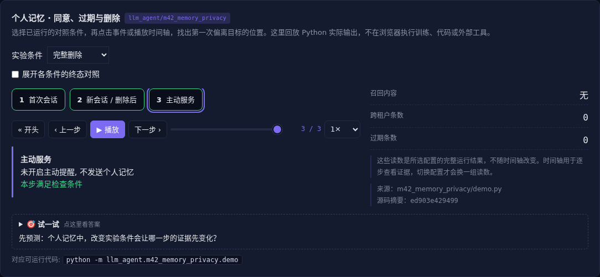

# 个人记忆 · 同意、过期与删除

[](https://beleev.github.io/llm-engineering-lab/#/agent/memory-privacy)

[Agent 目录](../README.md) · [交互实验](https://beleev.github.io/llm-engineering-lab/#/agent/memory-privacy)

## 直觉

原文记录删除之后, 为什么检索路径仍可能残留它的引用? 系统记住了用户的历史偏好, 就可以在未获额外授权时主动推送提醒吗?

- 召回前鉴权: 权限与有效期校验必须在检索索引阶段完成, 不能先全库读取再做事后过滤。在 3 条合成记忆对照中:
  - flat 模式绕过索引直接读取全库, 单次查询即泄露 1 条跨租户记录与 1 条已过期记录。
  - scoped 模式严格按 (租户, 用户, 主题) 作用域键查询索引, 仅召回合规有效的 1 条记录。
- 沿派生链路彻底删除: forget 核验归属后同步从原文表 raw、作用域索引 index 与最近召回缓存 cache 三处移除目标 id, 再次召回返回空列表; 若只删原文而遗留索引引用, 残余索引仍会暴露该记录痕迹。

## 核心原理

### 跨会话与主动服务分开测

写入记忆、跨会话被动召回与主动推送提醒属于三项独立的权限边界, 必须分别测试与授权。demo 将这三步拆分为三条独立 trace 逐项核验。
实验夹具为用户 Lin 预置 3 条合成记忆: org-a 租户下的 Python (expires=10) 与 Go (expires=1), 以及 org-b 租户下的 Rust (expires=10), 模拟当前时钟 now=5:
- 首次会话: 调用 recall("org-a", "Lin", "preference", 5) 按作用域召回, 返回 ['Python']; Go 因到期被跳过, Rust 因分属不同租户而不进入查询范围。
- 新会话复查: 使用同一三元组再次执行召回, 依然返回 ['Python'], 验证有效记忆可跨会话持久保留。
- 主动服务校验: notify 在 recall 基础上新增 opted_in 参数, 专门标识用户是否单独授权「主动提醒」; 当 opted_in=False 时直接返回空列表而不触发召回, 三种模式下的 proactive 计数均为 0。
存储授权不自动等价于打扰授权, 主动向用户推送个人记忆必须获得独立的显式同意。

### 层级与多模态不绕过权限

访问控制必须在索引召回阶段强制生效, 不能退化为全库召回后的下游过滤。
由于 index 以 (tenant, user, topic) 三元组为键组织, recall 仅检索当前调用方名下的键列表, 其他租户的记录 id 从源头就不会进入候选集。反例 flat 模式绕过 index 直接遍历 raw 全表, 一次读出 Python、Rust、Go 全部 3 条记录, 其中归属 org-b 的 Rust 造成 1 条跨租户越界; 若依赖下游过滤器事后剔除, 未授权的私密内容已流入中间处理环节, 过滤规则一旦漏判即构成真实泄露。
Memory 结构预留的 kind 字段对应多层级与多模态扩展场景: 同一条原始记忆往往会衍生出摘要层、完整正文、图片字幕、音频转录与原文件链接等多种形态。所有派生表示都必须严格继承源记录的作用域权限, 检索任意层级时均按同一三元组鉴权, 不能仅在最终读取原文时才做拦截 (本章 demo 仅演示了 text 一种 kind)。

### 删除与压缩的区别

记忆的过期、压缩与删除具有完全不同的数据生命周期语义, 删除必须沿全部派生存储同步抹除引用。
过期仅控制召回可见性: recall 只返回满足 expires > now 的记录。对于 expires=1 的 Go 记录, 在 now=5 时:
- scoped 模式在索引展开时自动跳过该记录。
- flat 模式忽略有效期检查直接返回, 产生 1 条过期召回。
上下文压缩仅缩减表示体积而保留记录本身; 真正的合规删除不仅要销毁原文, 还必须清除所有派生引用。由于每次 recall 都会把命中 id 列表写入 cache, 单条记忆至少同时存在于 raw、index 与 cache 三处。调用 forget("org-a", "Lin", "a") 时依次执行三步:
1. 校验目标记忆的 (tenant, user) 与调用方一致, 越权删除他人记忆时直接抛出 PermissionError。
2. 从 raw 字典删除原文记录。
3. 遍历 index 与 cache, 将目标 id (即 a) 从所有列表中移除并清理空键, 随后再次召回即返回空列表 []。
此外, 审计日志 audit 仅记录操作类型 operation (recall 或 forget) 与截断至 12 位的 sha256 散列 (scope_hash 或 id_hash), 不落盘任何个人正文, 避免已删除内容在审计日志中残留重现。

### 读代码的顺序

- `demo.py:MemoryService`

## 运行

```bash
python -m llm_agent.m42_memory_privacy.demo
```

默认只用标准库与本仓库模块, 不访问外网。

## 运行后应该看到什么

依次运行 `flat, scoped, forget` 三种条件, 输出结果与逐步轨迹。`main()` 对预期的成功和失败分别断言; 失败对照不是程序故障。网页可选择配置、播放或点击事件, 显示 Python 已运行记录, 不在浏览器里执行训练或工具。

## 与真实系统的差距

本模块仅用内存级合成数据演示记忆生命周期的四道管控检查点, 不构成生产级安全或法律合规实现。demo 未模拟身份认证 (核实调用方确系 org-a 的 Lin)、静态与传输加密, 以及离线冷备份中的级联擦除 (forget 仅清理进程内存中的 raw、index、cache 三处字典), 测试数据仅为内存中的 3 条合成记录。
实验输出的 3 条记录、1 次越界与 1 次过期读数, 旨在定位个人数据治理的四个关键拦截位置:
- 写入阶段: 强制校验用户 consent。
- 召回阶段: 按租户作用域索引与过期时间前置过滤。
- 删除阶段: 沿原文、索引与缓存全链路同步清理。
- 审计阶段: 仅保留散列摘要而不记录明文内容。
上述机制演示不能直接外推为满足特定隐私法规或生产平台的完整合规证明。

## 常见误区

“有相同概念的教学实验”不等于“复现完整论文或具备通用产品能力”。对照只隔离本章说明的变量; 其他假设变化需重新测。

## 自测题

只删原文而保留包含正文的摘要缓存, 算完整遗忘吗?

<details><summary>答案</summary>

不算, 派生数据仍可能泄露内容。遗忘需要沿数据派生关系清理。保留审计时应避免重新保存被删除的正文。

</details>
