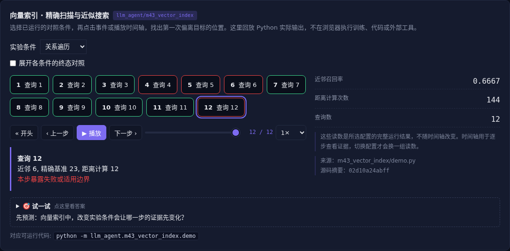

# 向量索引 · 精确扫描与近似搜索

[](https://beleev.github.io/llm-engineering-lab/#/agent/vector-index)

[Agent 目录](../README.md)

## 直觉

既然文档向量已经预先算好, 查询时直接逐个计算距离取最小值即可拿满召回率, 为什么生产检索还要专门构建树或图索引?

- 精确扫描基线: 给定查询向量寻找库中最近邻时, 精确扫描需遍历全库逐点计算距离; demo 在 24 个数据点上执行 12 次查询共计算 288 次距离, 召回率 (recall) 为 1.0。
- 近似最近邻索引以召回率换取更少的距离计算:
  - 单叶投影树每次查询仅计算叶内 3 个候选点, 累计 36 次距离计算, 但 12 次查询中漏判 2 次 (recall 为 0.8333)。
  - 邻近图搜索在预算为 12 时累计计算 144 次距离, recall 为 0.6667; 将预算放宽至全库规模 24 后 recall 恢复至 1.0。
- 评测任何近似向量索引时, 召回率基准始终是同一距离度量下的精确全量扫描。

## 核心原理

### 从词向量到语境向量

向量检索依赖前置的 embedding 模型将文本映射为连续空间坐标, 而索引结构本身只负责加速几何近邻查找。文本 embedding 技术经历了三代演进:
- 静态词向量 (如 Word2Vec): 每个词对应唯一固定的向量, 不随上下文改变, 例如「苹果」在水果与科技公司语境下共用同一向量。
- 上下文编码器: 同一词项的隐状态表示随所在句子的语境动态变化。
- 检索专用句向量: 对整句 token 表示做池化汇聚 (如均值池化), 并经对比学习等检索目标专门训练, 使语义相近的文本在向量空间中彼此靠近。
按表示形态划分, 检索向量又分为稠密向量 (各维均为连续非零实数)、稀疏向量 (绝大多数维度为 0, 如词项权重表) 与多向量表示 (单段文本保留多个细粒度向量), 三者需要匹配不同的索引结构。
本章实验专门隔离索引搜索开销, 不涉及 embedding 训练: 库中 24 个数据点是由 math.cos 与 math.sin 生成的二维螺旋线解析坐标, 并非经语料训练的语义表示; 同理, 仅靠哈希加随机投影得到的字词统计特征也不能等同于语义向量。

### 相似度不是语义保证

几何距离度量只反映向量空间中的远近关系, 并不直接等价于事实正确或证据充分。衡量两个向量接近程度常用三种度量函数, 未归一化时排序结果并不相同:
- 余弦相似度: 仅比较两个向量的夹角方向, 不受模长影响。
- 内积 (点积): 同时取决于向量夹角与各自模长。
- 欧氏距离: 度量两点在欧氏空间中的直线距离。
若先对所有向量做 L2 归一化 (将模长统一缩放为 1), 三种度量便会形成确定性的单调换算关系, 其中余弦相似度与点积数值完全相等。本章 distance 函数直接采用未归一化的平方欧氏距离。
工程中向量高分命中仅代表「embedding 模型判定表面或语义相近」, 无法保证事实无误或足以回答问题; embedding 模型、向量归一化策略与索引内部距离函数三者必须严格配套校验, 更换任一环节均需重新评测。

### 树与图怎样减少搜索

空间划分树与邻近图两类近似索引均通过剪裁候选范围来大幅削减距离计算次数。
投影树 (build_tree) 按 depth % 2 在 x 轴与 y 轴间交替选取分割维度, 每次取当前坐标轴中位数将点集递归二分, 直至每个叶节点最多包含 3 个点, 将 24 个点划分为 8 个叶节点。单次查询 (tree_query) 分三步执行:
1. 从根节点出发, 比较查询点坐标与超平面分割值以决定向左或向右分支下降。
2. 沿树路径直达唯一命中的叶节点。
3. 仅对该叶节点内的 3 个候选点计算距离并取最小值。
单次查询仅算 3 次距离, 12 次查询合计 36 次 (精确全量扫描需 288 次)。代价是 recall 降至 0.8333 (12 次查询命中 10 次): 查询 1 和 5 的真实最近邻 (点 1 和点 9) 恰好落在超平面分割边界另一侧, 未进入当前叶节点, 导致误返回点 0 和点 10。
邻近图 (build_graph) 为每个节点连接距离最近的 3 个邻居, 并附加序列相邻边保证连通。图查询 (graph_query) 同样分三步推进:
1. 从固定入口点 0 出发初始化最小堆与已访问集合。
2. 每轮弹出当前距离查询点最近的节点, 遍历其未访问邻居计算距离并更新全局最优解。
3. 当累计计算过距离的节点数达到预算上限 budget 时立即停止。
三档预算下的实测表现呈现清晰的计算与召回折中:
- budget=12: 每次查询计算 12 次, 合计 144 次, recall 为 0.6667。
- budget=24 (覆盖全库点数): 12 次查询全部命中真实最近邻。
- budget=1: 仅评估入口点 0, 12 次查询全部漏判。

### ANNOY 与 HNSW 的结构区别

工业界广泛使用的 ANNOY 与 HNSW 分别代表多树集成与分层邻近图两条近似检索路线, 本章实现了二者的最小核心骨架。
ANNOY (Spotify 开源的近似最近邻库) 同时构建多棵随机超平面投影树, 查询时在每棵树中各下探至一个叶节点, 将所有命中叶节点的样本合并去重为候选池后再精确计算距离; 森林规模与候选上限越大, 跨边界漏检概率越低, 但查询开销也同步上升。本章仅构建单棵确定性二分树, 因此 12 次查询出现 2 次边界漏判。
HNSW (Hierarchical Navigable Small World, 分层可导航小世界图) 将邻近图扩展为金字塔式的多层结构:
- 稀疏上层: 节点少、跳跃边跨度大, 负责在全局空间快速逼近目标区域。
- 稠密底层: 包含全量节点与局部短边, 负责在目标邻域精细扩展候选。
每个节点的最大邻居数 (邻接度) 与搜索时维护的动态候选队列宽度共同决定了索引内存占用、建库耗时与查询精度。本章简化为单层图结构, 每点连接 3 个最近邻并固定以点 0 作为搜索入口。

### 更新同样有成本

向量库发生动态增删时, 树索引与图索引的维护开销截然不同。
基于中位数切分的静态空间树难以保持局部平衡, 合入新一批向量通常需要全量重建整棵树。邻近图虽支持逐点增量插入, 但工程上必须额外解决节点删除后的墓碑清理、图连通性维护 (防止出现从入口不可达的孤岛节点) 以及高频插删引发的路由质量退化; 本章 build_graph 专门将每个节点与序列前后相邻节点相连, 以确保从入口点 0 出发必定可达全图任意节点。
完整验收一套近似索引时, 应以同一语料、同一距离函数下的精确扫描结果作为 recall 基准, 并同步报告距离计算次数、内存占用、建库耗时与增量更新成本; 本章实验仅统计了 recall 与距离计算次数两项指标。

### 读代码的顺序

- `demo.py:exact`
- `demo.py:build_tree`
- `demo.py:tree_query`
- `demo.py:build_graph`
- `demo.py:graph_query`

## 运行

```bash
python -m llm_agent.m43_vector_index.demo
```

本章只用标准库, 不下载嵌入模型。

## 运行后应该看到什么

精确扫描 recall 为 1; 单叶检索减少计算但可能漏召回。图的预算增至全体点数时, 返回值与精确基准一致。

## 与真实系统的差距

本实验采用固定二维螺旋点集与最简单树、单层图隔离搜索剪枝机制, 不能等价于完整生产级向量检索引擎。未实现的工程特性包括多棵随机树集成、HNSW 多层跳表、分割超平面边界回溯 (当查询点距分割面过近时回查另一侧子树)、动态增量插入与节点删除, 且未接入训练所得的语义 embedding。
实验输出的 288 / 36 / 144 为精确的距离函数调用计数而非硬件实测延迟 (未计入缓存局部性与 SIMD 向量化加速), 24 个二维点上的 recall 读数亦不可直接外推至高维百万级向量库。
索引按「每段文本一个向量」建。ColBERT (arXiv 2004.12832) 这类多向量检索每段文本存与 token 数相当的向量, 召回后按 MaxSim 重排, ColPali (arXiv 2407.01449) 对页面截图存一组图块向量; Matryoshka 表示 (arXiv 2205.13147) 允许截断维度做粗排。这三种做法都没有实现, 本章的距离调用计数也不能直接套到多向量索引上。

## 常见误区

索引召回率高不等于嵌入语义正确; 嵌入和索引要分开评估。

## 自测题

只搜一个树叶子可能漏召回的原因是什么?

<details><summary>答案</summary>

最近点可能位于分割边界另一侧。候选裁剪改变了可见范围, 需要多树或边界回溯等方法补召回。

</details>

近似索引效果应该与什么比较?

<details><summary>答案</summary>

同语料同度量的精确最近邻。先固定嵌入、语料与度量, 才能隔离索引的召回和成本。

</details>

## 表示与索引分开验收

二维固定向量只说明 ANN 机制, 不代表语义能力。[m45](../m45_semantic_retrieval/README.md) 补可训练表示与重排, 按 exact → ANN → rerank 对比; 候选里没有答案时, 重排无法补救。
