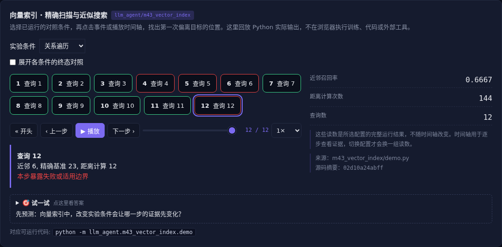

# 向量索引 · 精确扫描与近似搜索

[](https://beleev.github.io/llm-engineering-lab/#/agent/vector-index)

[Agent 目录](../README.md)

## 直觉

向量都算出来了, 为什么还需要索引?

近似索引用更少的距离计算换召回率, 必须保留精确基准。

## 核心原理

### 从词向量到语境向量

Word2Vec 为词存一个静态向量; 上下文编码器让同一个词随语境变化。

句向量还需池化与检索训练。

稠密、稀疏和多向量表示各有索引方式, 不能把随机投影的字词特征称为训练过的语义表示。

### 相似度不是语义保证

余弦比较方向, 点积受长度影响, 欧氏距离衡量空间距离。

归一化会改变三者关系; 嵌入相似也不证明事实正确或证据充分。

模型、归一化和索引度量应配套验证。

### 树与图怎样减少搜索

本例投影树只搜索一个叶子, 在分割边界可能漏掉最近点。

图搜索从入口沿邻居扩展, 用距离计算预算控制开销; 预算充足可回到精确结果, 小预算可能困在局部。

### ANNOY 与 HNSW 的结构区别

ANNOY 通过多棵随机投影树收集候选, 多树或更大搜索预算提高召回。

HNSW 使用多层邻近图, 上层快速定位, 底层扩展候选; 邻接度与搜索宽度影响内存、构建和查询。

### 更新同样有成本

静态树常用重建吸收新数据; 图结构可增量插入, 但也要处理删除、连通性和长期退化。

用精确近邻做 recall 基准, 同时报距离计算、内存、构建和更新代价。

### 读代码的顺序

- `demo.py:exact`
- `demo.py:build_tree`
- `demo.py:tree_query`
- `demo.py:build_graph`
- `demo.py:graph_query`

## 运行

```bash
python -m llm_agent.m43_vector_index.demo
```

本章只用标准库, 不下载嵌入模型。

## 运行后应该看到什么

精确扫描 recall 为 1; 单叶检索减少计算但可能漏召回。图的预算增至全体点数时, 返回值与精确基准一致。

## 与真实系统的差距

二维固定向量、单树和单层图的机制实验, 未实现完整 ANNOY/HNSW, 未训练语义嵌入。距离计算次数是实际计数, 不是生产延迟。

## 常见误区

索引召回率高不等于嵌入语义正确; 嵌入和索引要分开评估。

## 自测题

只搜一个树叶子可能漏召回的原因是什么?

<details><summary>答案</summary>

最近点可能位于分割边界另一侧。候选裁剪改变了可见范围, 需要多树或边界回溯等方法补召回。

</details>

近似索引效果应该与什么比较?

<details><summary>答案</summary>

同语料同度量的精确最近邻。先固定嵌入、语料与度量, 才能隔离索引的召回和成本。

</details>

## 表示与索引分开验收

二维固定向量说明 ANN 机制，不代表语义能力。[m45](../m45_semantic_retrieval/README.md) 补可训练表示与重排，按 exact→ANN→rerank 对比；候选里没有答案时，重排无法补救。
