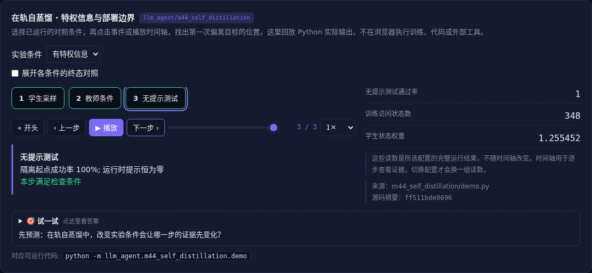

# 在轨自蒸馏 · 特权信息与部署边界

[](https://beleev.github.io/llm-engineering-lab/#/agent/self-distillation)

[Agent 目录](../README.md)

## 直觉

没有更强的教师, 让模型给自己当老师, 学到的不就是它已经会的吗?

教师和学生是同一个 nn.Linear(2, 2), 教师分支多看一列已验证的方向提示。有提示: 测试起点成功率 0 → 1; 没提示: 第 1 步和第 35 步 KL 都是 0, 成功率还是 0。部署时提示通道恒为 0。

## 核心原理

### 同一个模型, 不同的信息

教师和学生共用同一个 nn.Linear(2, 2) 的参数, 输入是 [position, hint]。学生的 hint 恒为 0; 教师分支的 hint 按位置正负给 +1 / -1, 是已验证的方向。

优势全来自这一列信息。初始权重 [[-0.1, 2], [0.1, -2]] 里, hint 列的 ±2 让教师会用提示, position 列的 ∓0.1 让学生一开始朝反方向走。

前提是模型本来就会用提示, 不是凭空多了一个更聪明的模型。

### 在学生实际访问的状态上蒸馏

每步让学生从 4 个训练起点 (-3, -1, 1, 3) 按当前策略采样, 最多走 7 步, 走到 0 算成功; 走过的位置就是训练集, 由学生自己的动作决定。

对这些位置算教师分布, 用 llm_finetune 现成的 token_kl (reverse KL) 更新学生; 教师分支在 torch.no_grad 下, 梯度在这里截断。SGD lr=0.08, 共 35 步。

### 没有额外信息时会怎样

no-hint 模式把教师的 hint 也置 0: 同参数、同输入, 两个分布完全一样, 第 1 步和第 35 步的 KL 都是 0.0。

参数没动, 测试成功率训前训后都是 0。自己复制自己, 不是学习信号。

### 答案隔离与保持

rollout 和 score 的输入永远是 [position, 0.], 提示通道恒为 0, 已验证信息只在训练侧的教师分支用。hint 列的权重两组都停在 2.0, 教师分支没有反传更新它。

测试起点 (-4, -2, 2, 4) 和训练起点 (-3, -1, 1, 3) 不交叉, 但轨迹经过的位置可能重叠; 这里验证的是控制规则迁移, 不是分布外的语言推理。

### 自蒸馏仍会失败

特权信息错了, 或教师用不了它, 学生就照样复制错误。本章把 hint 定义成正确方向, 把 hint 列权重预设成 ±2, 两个前提都是人给的。

真实场景里参考答案、人工示范、领域材料都要授权和校验; 还要靠保持正则、风格评估和安全回归限制副作用, 本章没做这三项。

### 读代码的顺序

- `demo.py:rollout`
- `demo.py:score`
- `demo.py:train`

## 运行

```bash
python -m llm_agent.m44_self_distillation.demo
```

本章复用仓库已有 PyTorch 与 KL 实现, 在 CPU 上训练。

## 运行后应该看到什么

没有特权信息时 KL 为零, 策略不变; 有提示时参数更新, 无提示的不同起点测试通过。

## 与真实系统的差距

没模拟的: 语言模型、token 级分布、完整的 OPSD 配方。策略是 4 个参数的线性控制器, 提示通道的利用能力是预设的, 不是学出来的。

训练确实更新了参数 (成功率 0 → 1), 但只证明已验证的额外信息能被蒸馏进学生, 不证明未知知识能被自我创造。

## 常见误区

共享模型参数不代表可自动创造知识; 额外信息及模型利用它的能力是前提。

## 自测题

教师和学生看到相同输入且共享同一参数, KL 是多少?

<details><summary>答案</summary>

零, 没有新的分布差异提供监督。角色名称本身不产生监督; 信号来自额外信息、不同条件或经验证反馈。

</details>

训练用到参考答案后, 部署接口应怎样处理?

<details><summary>答案</summary>

移除答案通道并独立测试效果。训练侧特权条件不能泄漏到部署或测试决策。

</details>
