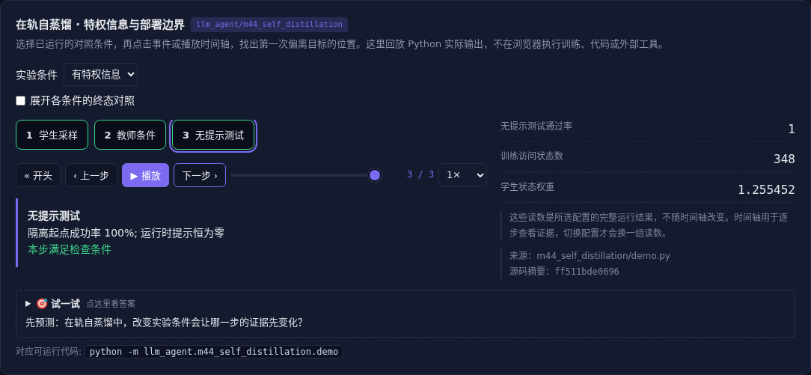

# 在轨自蒸馏 · 特权信息与部署边界

[](https://beleev.github.io/llm-engineering-lab/#/agent/self-distillation)

[Agent 目录](../README.md)

## 直觉

没有更强的教师, 同一个模型能给自己监督吗?

教师分支可以多看验证信息, 学生部署时仍只能看普通观察。

## 核心原理

### 同一个模型, 不同的信息

教师和学生共用参数, 教师分支额外接收经验证的方向提示。优势来自信息条件, 不是凭空多了一个更聪明的模型; 模型须已有利用提示的能力。

### 在学生实际访问的状态上蒸馏

学生按当前策略走向目标, 由自己的动作决定后续状态。

对这些状态计算教师分布, 用现有 reverse KL 更新学生; 教师分支用 no_grad 截断梯度。

### 没有额外信息时会怎样

教师和学生看到同样输入、使用相同参数, 两个分布相同, KL 为零。不能把自我重复当作新的学习信号。

### 答案隔离与保持

部署接口的提示通道始终为零, 只在训练侧使用已验证信息。

测试起点与训练起点不同, 轨迹状态可能重叠; 这里只验证控制规则迁移, 不声称分布外语言推理。

### 自蒸馏仍会失败

如果特权信息错误或教师无法利用它, 就会复制错误。参考答案、人工示范或领域材料需要授权和校验; 保持正则、风格评估和安全回归限制副作用。

### 读代码的顺序

- `demo.py:rollout`
- `demo.py:score`
- `demo.py:train`

## 运行

```bash
python -m llm_agent.m44_self_distillation.demo
```

本章复用仓库已有 PyTorch 与 KL 实现, 在 CPU 上训练。

## 运行后应该看到什么

没有特权信息时 KL 为零, 策略不变; 有提示时参数更新, 无提示的不同起点测试通过。

## 与真实系统的差距

四参数线性控制策略, 提示通道的利用能力预先设定。训练确实更新参数, 但不是完整语言模型 OPSD 配方, 不证明未知知识能被自我创造。

## 常见误区

共享模型参数不代表可自动创造知识; 额外信息及模型利用它的能力是前提。

## 自测题

教师和学生看到相同输入且共享同一参数, KL 是多少?

<details><summary>答案</summary>

零, 没有新的分布差异提供监督。角色名称本身不产生监督; 信号来自额外信息、不同条件或经验证反馈。

</details>

训练用到参考答案后, 部署接口应怎样处理?

<details><summary>答案</summary>

移除答案通道并独立测试效果。训练侧特权条件不能泄漏到部署或测试决策。

</details>
