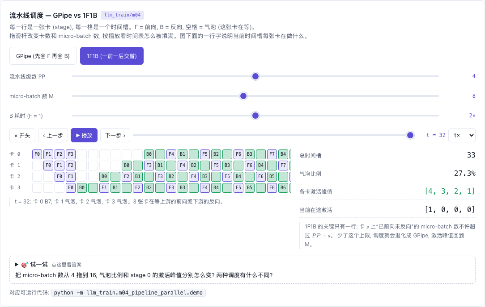

# M04 — 流水线并行: GPipe / 1F1B / Interleaved / Zero Bubble

[](https://beleev.github.io#/train/model-parallel)

[打开相关交互实验：流水线并行调度 — GPipe 和 1F1B 的时间表: 气泡在哪, 显存差在哪 llm_train/m04](https://beleev.github.io#/train/model-parallel)

## 直觉

层切成 PP 段分给 PP 张卡, batch 切成 M 个 micro-batch 依次流过。开头和结尾总有卡在等 → **气泡**。每个 "已前向、未反向" 的 micro-batch 都要留着激活 → **在途激活**。
- GPipe: 全部 F 完再 B。在途 = M。
- 1F1B: stage s 先做 PP-1-s 个 F, 之后 F/B 交替。在途 = PP-s。**气泡不变, 只省显存。**
- Interleaved: 每卡放 v 个不相邻的小 stage, 流水线 "绕 v 圈", 气泡 ÷ v。交错后一份在途激活只有 1/v 个 stage 大, 和 1F1B 比较时要先折算。
- Zero Bubble (ZB-H1): 把完整反向拆成 **B** (只算对输入的梯度, 要立刻传给上一个 stage) 和 **W** (只算对权重的梯度, 谁都不等它)。W 往后挪去填这张卡本来空着的格子, 收尾那一片三角形空白就被填掉了。
- DualPipe (DeepSeek-V3): 两端同时喂 micro-batch 的双向流水线, 用一对前向与反向块的计算掩盖 all-to-all 和 PP 通信。本模块不排它的时间表, 只按报告的代价公式算。

## 核心原理

### 核心公式

气泡占比 = `(PP-1) / (v·M + PP-1)`; demo 中 B 占 2 格 (反向 ≈ 2× 前向), 公式不变。

拆开反向之后换成"每卡空闲多少格"来比 (`t_f` / `t_b` / `t_w` 分别是 F / B / W 占的格数):

| 调度 | 每卡空闲 | 在途激活峰值 |
|---|---|---|
| 1F1B | `(PP-1)(t_f + t_b + t_w)` | `PP · M_B` |
| ZB-H1 | `(PP-1)(t_f + t_b - t_w)` | `PP · M_B` |
| ZB-H2 | `(PP-1)(t_f + t_b - 2·t_w)` | `(2·PP-1) · M_B` |

这是 Zero Bubble 论文 (Qi et al., ICLR 2024) 表 2 的三行, `M_B` 是一份待反向激活的大小。三者耗时相等时 ZB-H1 的空闲正好是 1F1B 的 1/3, ZB-H2 正好为 0 —— "降到 1/3" 和 "零气泡" 这两句话都带着 `t_f = t_b = t_w` 这个前提, 论文实测的比例是 `T_W < T_F < T_B` 且 `T_B + T_W = 2·T_F`。

ZB-H1 的每卡在途份数都是 PP (1F1B 是 `PP - s`), 但做完 B 只等 W 的那部分只需要 `M_W`, 比 `M_B` 小; 卡 0 上 PP 份全是大的那种, 所以峰值仍由卡 0 决定, 与 1F1B 相等。本模块的 `simulate_zb` 只数份数, 不区分 `M_B` 和 `M_W`。

### DualPipe 的代价公式

DeepSeek-V3 技术报告表 2 (`F` 是一次前向, `B` 是一次**完整**反向 = 本模块的 `t_b + t_w`, `W` 只算权重梯度, `F&B` 是一对前向与反向合并执行的块):

| 调度 | 每卡空闲 | 参数份数 | 在途激活 |
|---|---|---|---|
| 1F1B | `(PP-1)(F+B)` | 1× | `PP` |
| ZB1P | `(PP-1)(F+B-2W)` | 1× | `PP` |
| DualPipe | `(PP/2-1)(F&B+B-3W)` | 2× | `PP+1` |

换成本模块的符号, ZB1P 那一行就是 `(PP-1)(t_f + t_b - t_w)`, 也就是 ZB-H1 —— 两篇论文不矛盾, 只是 `B` 的定义不同。DualPipe 要求 stage 数和 micro-batch 数都能被 2 整除, 每卡存两份参数, 在途激活多 1 份。

## 运行

运行: `python -m llm_train.m04_pipeline_parallel.demo`

## 运行后应该看到什么

### (PP=3, M=6)

```
GPipe 气泡 (实测 / 公式)            = 25.0% / 25.0%
1F1B 气泡                          = 25.0% / 25.0%
Interleaved v=2 气泡               = 14.3% / 14.3%
GPipe / 1F1B 在途激活峰值           = [6, 6, 6] / [3, 2, 1]
PP=3, M=4: 1F1B 峰值 = [3, 2, 1];  PP=4, M=8: [4, 3, 2, 1]   ← 精确断言
PP=4, M=8: 气泡 1F1B → 交错(v=2)    = 27.3% → 15.8%
PP=4, M=8: 交错在途峰值             = [11, 9, 7, 5] 份 1/2-stage 激活 = 5.5 个 stage (1F1B 为 4)
```

### Zero Bubble 与 DualPipe (PP=4, M=8, F / B / W 各占 1 格)

```
[Zero Bubble ZB-H1]  PP=4, M=8; 1 格 = 1 个 stage 的前向; B 和 W 各占 1 格
  s0: F0 F1 F2 F3  .  .  . B0 W0 F4 B1 W1 F5 B2 W2 F6 B3 W3 F7 B4 W4 B5 W5 B6 W6 B7 W7
  s1:  . F0 F1 F2  .  . B0 F3 B1 W0 F4 B2 W1 F5 B3 W2 F6 B4 W3 F7 B5 W4 B6 W5 B7 W6 W7
  s2:  .  . F0 F1  . B0 F2 B1 F3 B2 W0 F4 B3 W1 F5 B4 W2 F6 B5 W3 F7 B6 W4 B7 W5 W6 W7
  s3:  .  .  . F0 B0 F1 B1 F2 B2 F3 B3 W0 F4 B4 W1 F5 B5 W2 F6 B6 W3 F7 B7 W4 W5 W6 W7

1F1B 总时长 / 每卡空闲                    = 33 格 / 9 格
ZB-H1 总时长 / 每卡空闲                   = 27 格 / 3 格
气泡占比 1F1B → ZB-H1                  = 27.3% → 11.1%  (比值 0.41)
在途激活峰值 1F1B / ZB-H1                = [4, 3, 2, 1] / [4, 4, 4, 4]  (峰值都是 4)

PP=4 每卡空闲 / 参数份数 / 在途激活 (代价模型)     = 1F1B 9/1x/4; ZB1P 3/1x/4; DualPipe 1/2x/5
PP=8 每卡空闲 / 参数份数 / 在途激活 (代价模型)     = 1F1B 21/1x/8; ZB1P 7/1x/8; DualPipe 3/2x/9
PP=16 每卡空闲 / 参数份数 / 在途激活 (代价模型)    = 1F1B 45/1x/16; ZB1P 15/1x/16; DualPipe 7/2x/17
```

断言: 在 (PP, M) 的 5 组配置 × (t_f, t_b, t_w) 的 4 组耗时上, 事件模拟的每卡空闲都等于 `(PP-1)(t_f+t_b-t_w)`, 在途峰值都等于 `[PP] * PP`; 依赖关系逐个 micro-batch 核对 (W 在自己的 B 之后、B 在下一个 stage 的 B 之后、F 在上一个 stage 的 F 之后); 代价模型里空闲依次是 1F1B > ZB1P > DualPipe, 且 DualPipe 的参数份数是 ZB1P 的 2 倍。

气泡占比的比值是 0.41 而不是 0.33, 因为占比的分母是总格数而不是"每卡空闲": 每卡空闲确实是 9 → 3 格 (正好 1/3), 但总格数从 33 降到 27, 分母也小了。

## 与真实系统的差距

- 只模拟调度时间表, 没有真的算梯度; P2P 通信时间记为 0 (交错调度的 P2P 次数是 v 倍)。
- Zero Bubble 只做了 ZB-H1。ZB-H2 (允许峰值升到 `(2·PP-1)` 份换取零气泡) 和 ZB-V (把模型切成 `2·PP` 块按 V 字形分配, 在 1F1B 的显存下做到零气泡) 只给了公式, 没有排时间表; ZB-V 只在 Zero Bubble 的 arXiv 扩展版里, ICLR 发表版没有这一节, 后续论文是 arXiv 2405.15362。
- DualPipe 只按报告的代价公式算, 没有排双向时间表。报告的 `F&B` 是"计算掩盖通信"之后的耗时, 本模块按 `F + B` 取值 (通信被掩盖, 计算量不变), 真实值要看具体的 SM 分配。
- W 的插入用的是贪心规则 (没别的事可做, 或者在途满了就补一个 W), 不是论文第 3 节那个按运行时 profile 解整数规划的自动调度器。
- 真实系统各 stage 耗时不均 (embedding / 输出头), 需要不均匀切层。

## 常见误区

- "1F1B 比 GPipe 快" —— 同样的气泡; 它的价值是在途激活从 M 降到 PP, 于是可以把 M 开大, **间接**减小气泡。
- "交错调度白赚" —— 在途激活更多 (stage 0 有 11 份半个 stage 的激活, 折算 5.5 个 stage; 1F1B 是 4 个), P2P 通信 v 倍。

## 自测题

1. PP=8, M=64 的气泡? **答: 7/71 ≈ 9.9%。**
2. 1F1B 下哪个 stage 激活压力最大? **答: stage 0, 在途 PP 份。**
3. 想把 PP=4, M=8 的气泡压到 10% 以下, 三种办法? **答: M ≥ 28; 或保持 M=8 用交错 v ≥ 4 (3/(4·8+3)=8.6%); 或拆开反向用 ZB-H1 (11.1%, 还差一点, 再配 M=12 就是 7.7%)。**
4. PP=8 时 ZB-H1 的每卡空闲比 1F1B 少几格 (F / B / W 各 1 格)? **答: 21 - 7 = 14 格; 两式分别是 7×3 和 7×1。**
5. 为什么 W 可以往后挪, B 不行? **答: B 算出的输入梯度是下一个 stage 的输入, 挪晚了整条流水线跟着等; W 算出的权重梯度只在这一步的优化器更新前要用到, 谁都不等它。**
