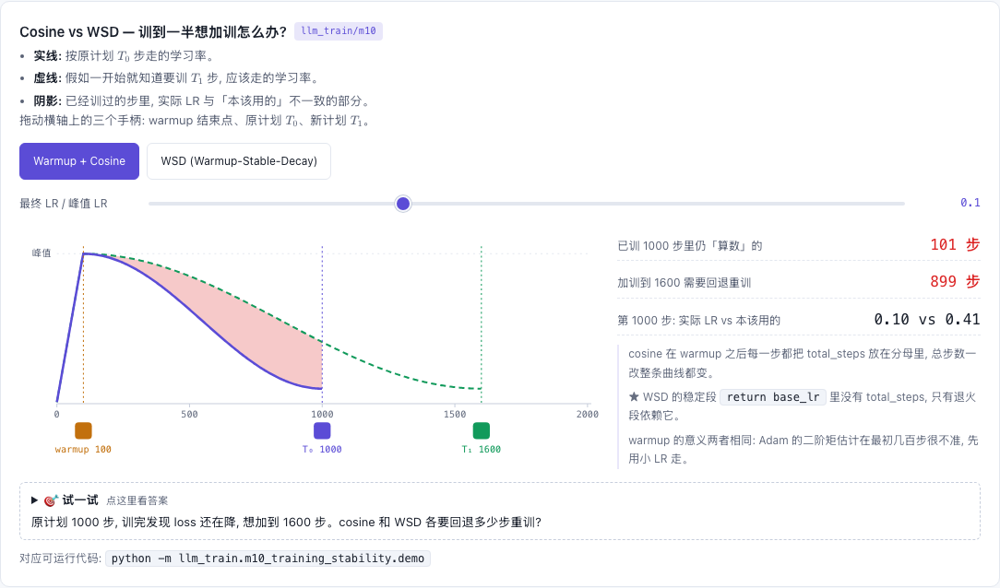

# M10 — 训练稳定性: cosine / WSD · 梯度裁剪 · NaN guard · z-loss

[](https://beleev.github.io#/train/lr-schedule)

[打开相关交互实验：学习率调度 Cosine vs WSD — 训到一半想加训, 要回退多少步重训? llm_train/m10](https://beleev.github.io#/train/lr-schedule)

## 直觉

- **warmup**: Adam 的二阶矩估计开头不准, 先用小 lr。
- **cosine** 平滑降到 ~0, 但曲线形状依赖总步数 —— 想多训一点, 整条曲线都得换。
- **WSD** (warmup-stable-decay): 大部分时间 lr 恒定, 最后 ~10% 快速退火。稳定段与总步数无关 → 任何稳定段 checkpoint 都能继续训, 或分叉出一个 decay 分支来评测。
- **全局范数裁剪**: 偶发的梯度尖峰只缩长度、不改方向。
- **NaN guard**: 坏 step 直接丢弃, 参数零改动。
- **z-loss**: 交叉熵对 logits 整体加同一个常数不敏感, 这个方向没人管, `log Z` 就会一路往上漂。加一项 `c_z · mean(log² Z)` 把它拉回 0 附近。

## 核心原理

### 核心公式

`cosine: lr = base·(r + (1-r)·½(1+cos(π·p)))`; `WSD: lr = base (stable), base·(1-(1-r)·p) (decay)`;
`clip: g ← g·min(1, c/‖g‖₂)`, 范数取**所有参数**拼在一起的 L2;
`z-loss: L += c_z · mean(log² Z)`, `Z = Σ exp(logit)` 是 softmax 的归一化因子。

符号:
- `base`: warmup 结束时的 lr, 也是最大 lr。
- `r`: 最低 lr 与 base 的比值 (代码里的 `min_ratio`, demo 取默认值 0)。
- `p`: 当前段的进度, 从 0 到 1。cosine 从 warmup 结束算起, WSD 从 decay 开始算起。
- `c`: 裁剪阈值 (demo 取 5)。
- `c_z`: z-loss 的系数。PaLM 对输出头用 `1e-4`, ST-MoE 对 MoE 路由器用 `1e-3`。

z-loss 的梯度是 `∂/∂logit_j [log² Z] = 2 · log Z · softmax_j`: 它按 softmax 的分布把所有 logit 一起往下压, 不改变 logit 之间的差, 所以 top-1 不变。

## 运行

运行: `python -m llm_train.m10_training_stability.demo`

## 运行后应该看到什么

```
步            = [0, 9, 30, 60, 89, 95, 99]
cosine ×1e-3  = [0.1, 1.0, 0.883, 0.413, 0.036, 0.008, 0.0]
WSD    ×1e-3  = [0.1, 1.0, 1.0, 1.0, 1.0, 0.5, 0.1]
总步数 100→200, 前 90 步 lr 最大变化 = cosine 5.96e-04,  WSD 0.00e+00
‖g‖ 裁剪前 → 后 = 111.83 → 5.00 (scale=0.0447);  方向 cos 相似度 = 1.000000
坏 step: 执行? / 参数被改? = False / False

[4] z-loss (PaLM 的 1e-4·log²Z): 输出头 16 类, 3000 步, 可分数据
lr=0.5 mean log Z (c_z = 0 / 1e-4 / 1e-3) = 13.36 / 12.46 / 8.03
lr=0.5 max logit                   = 26.95 / 25.05 / 16.10
lr=0.5 交叉熵 (不含 z-loss)             = 0.0251 / 0.0290 / 0.0611
lr=8.0 (偏大) mean log Z (c_z = 0 / 1e-4 / 1e-3) = 21.85 / 10.93 / 1.50
lr=8.0 (偏大) max logit              = 44.31 / 23.55 / 10.45
lr=8.0 (偏大) 交叉熵 (不含 z-loss)        = 0.0018 / 0.0082 / 0.0159
lr=8.0 (偏大) top-1 正确率              = 1.000 / 1.000 / 1.000
fp16 下 exp(logit) 溢出的 logit 阈值     = 11.1
bf16 下 exp(logit) 溢出的 logit 阈值     = 88.7
3 个种子的 log Z (无 / 1e-4)            = 21.8→10.9; 21.8→11.2; 21.5→11.5

[5] router z-loss (ST-MoE 的 1e-3): 路由器 8 个专家, 3000 步, lr=8.0
router mean log Z (c_z = 0 / 1e-3) = 23.06 / 0.60
router max logit                   = 47.37 / 10.98
router top-1 专家选对的比例               = 1.000 / 1.000
```

z-loss 的断言: lr 偏大时不加 z-loss 的 `log Z` 漂到 20 以上; `c_z = 1e-4` 把它压到不加时的 60% 以下; 系数越大压得越靠近 0; 三档的 top-1 都是 1.000, 但交叉熵本身变差; 三个种子上方向一致。

## 与真实系统的差距

- 真实 WSD 的 decay 形状常用 `1-sqrt` 或指数; decay 段往往同时换成高质量数据。
- 分布式下范数要跨 TP/PP/ZeRO 分片聚合 (full_loop 演示了 ZeRO 版)。
- 真实的 spike 处理还包括: 回滚到上一个 checkpoint 并**跳过那段数据**、QK-norm / QK-clip (→ m14)。
- z-loss 的演示是一个 16 类 softmax 分类器, 3000 步、单种子三次重复。真实的收益是 PaLM 报告的"训练更稳、loss spike 更少", 这个在玩具上看不到: demo 能看到的只是 `log Z` 确实会漂、z-loss 确实拉得住、代价是交叉熵变差。
- 把训练好的 logits 舍入到 bf16 再算 softmax, 三档的最大概率偏差都在 1e-3 量级, 没有随 `log Z` 一起降 (加了 z-loss 之后分布更平, 可被扰动的概率质量更多)。z-loss 防的是 `log Z` 无界增长本身, 而不是这个规模上的舍入误差。

## 常见误区

- "裁剪阈值越小越稳" —— 长期处于被裁状态等于在偷偷降 lr。
- "逐参数裁剪也一样" —— 那会改变梯度方向。
- "先 clip 再查 NaN" —— NaN 的范数还是 NaN, clip 救不了它 (PyTorch 里缩放系数本身变 NaN, 污染全部参数)。
- "z-loss 会改变模型的预测" —— 它只压 logits 的整体高度, 不改 logit 之间的差。demo 里三档的 top-1 正确率都是 1.000, 路由器选哪个专家也完全没变。
- "z-loss 和 weight decay 一回事" —— weight decay 压的是权重范数, z-loss 盯的是 `log Z` 这一个标量, 对 logits 整体平移的那个自由度直接施压。
- "加了 z-loss 就免费" —— 它是额外约束。demo 里 lr=8.0 时交叉熵从 0.0018 升到 0.0159 (`c_z = 1e-3`), 系数要在稳定性和拟合之间挑。

## 自测题

1. WSD 相对 cosine 最大的工程好处? **答: 稳定段与总步数解耦, 可随时续训 / 从任一 checkpoint 分叉做 decay。**
2. ‖g‖=111.83, c=5, 缩放系数? **答: 5/111.83 ≈ 0.0447。**
3. loss scale 回退和 NaN guard 的关系? **答: 同一个检测 (`has_overflow`), AMP 多做一步 "scale 减半"。**
4. 为什么交叉熵管不住 `log Z`? **答: softmax 对 logits 整体加同一个常数的结果不变, 所以交叉熵在这个方向上的梯度是 0, 整体高度是个自由参数。**
5. fp16 下算 softmax, logit 超过多少会让 `exp` 溢出? **答: `log(65504) ≈ 11.1`。实现里先减最大值能绕过这一步, 但 logits 本身仍要能被存下来。**
