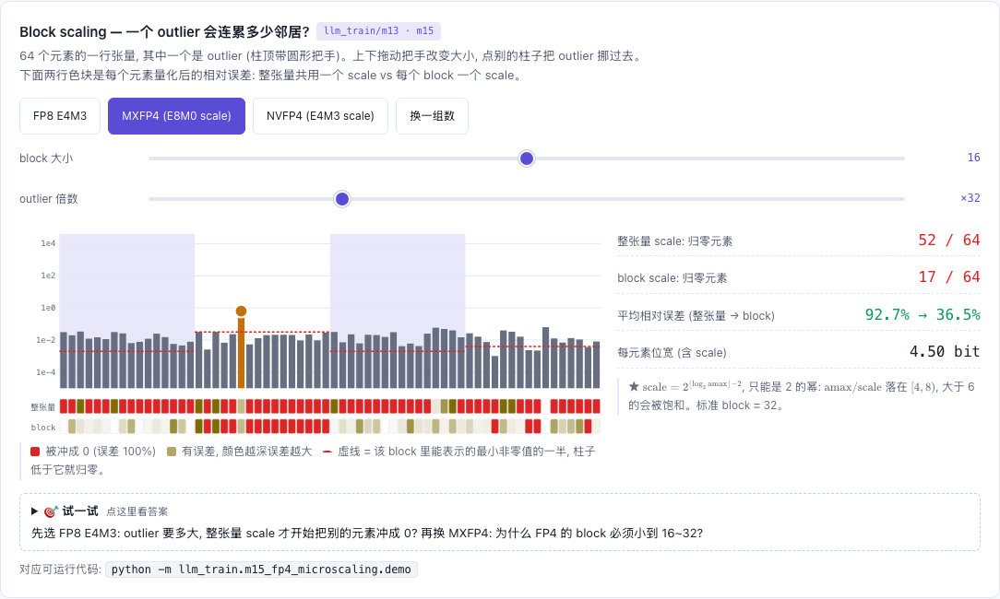

# M15 — Microscaling FP4 (MXFP4 / NVFP4)

[](https://beleev.github.io#/train/low-precision)

[打开相关交互实验：Block scaling — 低位宽量化时, 一个 outlier 会连累多少邻居? llm_train/m13 · m15](https://beleev.github.io#/train/low-precision)

## 直觉

E2M1 只有 `±{0, 0.5, 1, 1.5, 2, 3, 4, 6}`。单靠它什么都表示不了, 精度全靠 "每一小块共享一个 scale"。两种格式的区别只在 scale:
- **MXFP4** (OCP): block 32, scale 是 2 的幂 (E8M0)。硬件最简单 (移位), 但对不准 amax。
- **NVFP4**: block 16, scale 是 E4M3 (有尾数) 再乘一个 per-tensor FP32 scale。amax 精确贴到 6。

## 核心原理

### 核心公式

`MXFP4: s = 2^(⌊log₂ amax⌋ − 2)`, `amax/s ∈ [4, 8)`, 大于 6 的饱和。
`NVFP4: s = Q_E4M3(amax / 6 / s_tensor) · s_tensor`。
每元素 bit 数: MXFP4 `4 + 8/32 = 4.25`, NVFP4 `4 + 8/16 = 4.5`。

## 运行

运行: `python -m llm_train.m15_fp4_microscaling.demo`

## 运行后应该看到什么

```
相对量化误差                      高斯 (权重)   重尾 (激活/梯度)
FP8 E4M3 block128 (8.25 bit)       0.0259        0.0228
NVFP4  block16    (4.50 bit)       0.0947        0.0913
MXFP4  block32    (4.25 bit)       0.1133        0.1420
INT4   block32    (4.50 bit)       0.0963        0.1472
同为 block16: E8M0 scale vs E4M3 scale = 0.1138 vs 0.0947
INT4 / MXFP4 (高斯, 重尾) = [0.85, 1.04]x
MXFP4 中最大值被饱和截断的 block = 42%
```
断言: FP8 < NVFP4 < MXFP4; 同 block 大小下差距全来自 scale 精度; **高斯数据上 INT4 比 MXFP4 更准**, 重尾数据上反过来 (对数间距的浮点网格擅长重尾)。

## 2026 年的现状: 全栈 FP4

早期的 NVFP4 预训练工作主要只把 Transformer 的线性投影量化到 4 位, 优化器状态、优化器自身的计算和注意力的前反向路径仍是高精度。**Full-Stack FP4** (arXiv 2607.04422) 把这三块也量化了, 四份配方各自解决一个问题:

- **线性投影**: LoRA-SVD 把一个紧凑的投影子空间留在 BF16, 其余保持全形状 NVFP4 计算, 只量化线性层的 loss 差距从 1.40% 降到 0.61%。
- **优化器状态**: 先开平方、再按 tile 取均值、再做 Hadamard 变换的顺序化流水线, 让 AdamW 的动量能稳定地存成 NVFP4。
- **优化器计算**: 正交化迭代 (论文称 Root, 就是 Muon 那一步) 直接在 NVFP4 上做, 靠形状相关的系数和裁剪稳住。
- **注意力**: 混合精度, 对 softmax 敏感的算子留在 BF16, 不是全部 FP4。

结果是 3B 模型 64B token 预训练, BF16 的 loss 2.267 对 Full-Stack FP4 的 2.286, 差 0.838%; 平均 zero-shot 困惑度 26.675 对 26.665, 准确率平均低 0.10 个百分点。单张 RTX 5090 上的四块实测: Root 比优化过的 BF16 快 2.50 到 2.83 倍, AdamW 峰值显存低 37.9% 到 42.5%。这两个数字是单算子和单项显存, 不是端到端训练的加速比。

只做 4 位注意力的另有专论 (arXiv 2603.00040, Attn-QAT), 它指出稳定的 FP4 注意力有两个要点: 反向里重算注意力分数时要用同样的低精度, 以及要处理 FlashAttention 梯度计算里隐含的精度假设。

本模块只量化一次权重和激活, 以上几条都没有实现。

## 与真实系统的差距

- 只测了一次性量化误差, 没有做 FP4 训练。全程 FP4 预训练 (NVIDIA 2025 的 NVFP4 方案) 还需要: 随机舍入、Hadamard 旋转打散 outlier、部分层保留 BF16、后期切回高精度。
- 没有量化优化器状态、优化器计算和注意力 —— 这三块是 Full-Stack FP4 的内容, 见上一节。
- 假量化, 不涉及 4-bit 打包和 FP4 GEMM 核。
- INT4 的 scale 按 FP16 计 (4.5 bit), 真实 INT4 方案 (GPTQ/AWQ) 还有 zero-point 和 group size 128 等变体。

## 常见误区

- "FP4 一定比 INT4 好" —— 取决于分布; 高斯权重上 INT4 不输。
- "MXFP4 和 NVFP4 只是 block 大小不同" —— 更关键的是 scale 的数值格式。
- "4 bit 就是 4 bit" —— 要把 scale 摊进去: 4.25 / 4.5 bit。
- "FP4 训练就是把 GEMM 换成 FP4" —— 显存和带宽的大头还有优化器状态和注意力。Full-Stack FP4 把 AdamW 动量也存成 NVFP4, 峰值显存才降了 37.9% 到 42.5%。

## 自测题

1. E2M1 能表示多少个不同的值? **答: 15 个 (±7 个非零 + 0; ±0 算一个)。**
2. 为什么 MXFP4 会饱和? **答: 2 的幂 scale 下 amax/s 落在 [4,8), 超过 6 的被截到 6 (demo 中 42% 的 block)。**
3. NVFP4 为什么还需要 per-tensor scale? **答: block scale 存成 E4M3, 范围只有 ±448, 要先把它搬进这个范围。**
